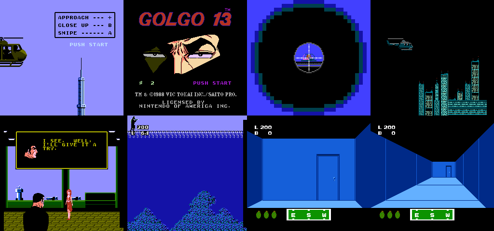

<p align="center"></p>

# Golgo 13: matching decompilation and native PC port (NES)

A work-in-progress **matching decompilation** of *Golgo 13* for the Famicom/NES, in both releases, with a **native Windows build that runs the decompiled game logic directly** (no emulated CPU).

| Version | Game | Notes |
|---|---|---|
| `us` | Golgo 13: Top Secret Episode (USA, Vic Tokai) | localized release |
| `jp` | Golgo 13: Daiisshou - Kamigami no Tasogare (Japan) | original release; 19 % of the bytes differ (text, banks 3-5, CHR) |


<sub>Pictures from the native port built from this repository (US version). The game is not included here: you supply your own ROMs.</sub>

## Where the project stands

| | |
|---|---|
| Assembly | ca65 source that rebuilds each 256 KB ROM **byte for byte** (`python tools/build.py` prints `MATCH` for both versions). ByteMatch reports `us` / `jp` are 100 %. About 38.9 KB of code in 921 (US) / 928 (JP) routines; every other byte is data (`.incbin` of files extracted from your ROM). About 780 routines and the important RAM variables have names; about 100 (US) / 140 (JP) are still `Sub_...` |
| C lifting | every routine is lifted mechanically to C (`c/auto/<ver>/`) and checked against the original 6502 code: per-routine tests on random and real-play RAM images, plus whole-program runs (up to 36,000 frames from power-on, with forced scene changes and random objects) in which RAM, I/O writes and the PRG bank are identical after every frame. ByteMatch reports `us_c` / `jp_c` are 100 % (how that is established: see below) |
| Readable C | 115 routines are rewritten by hand with names, comments and structure (`c/golgo13.c`, `c/golgo13_game.c`) and tested against the original on thousands of states (`tools/difftest.py`) |
| Native port | `c/port/`: the lifted game logic on a PPU / APU / mapper host written for this project, an SDL2 window, controller and keyboard input. Pictures match NESRecomp's cycle-checked interpreter pixel for pixel in 56 of 56 random-route frames (US and JP); sound matches its pitches and volume envelopes (see *Native port* below) |
| Hardware | MMC1 (mapper 1), 8 x 16 KB PRG (banks 0-6 switchable at `$8000`, bank 7 fixed at `$C000`), 128 KB CHR-ROM, NES 2.0 header |

### What each ROM bank does
| Bank | Contents |
|---|---|
| 0 | street-scene level data (maps, tile and object tables); no code of its own |
| 1 | street enemies and items (object table at `$0310`, 16 bytes each), title screen, game over screen |
| 2 | sniper-scope stages and palette tables |
| 3 | dialogue and briefing scenes (portrait text boxes) |
| 4 | the first-person building scenes: 3-D corridors with doors and a compass, 18 mazes, enemies, ammo and life items |
| 5 | intro, helicopter briefing, title, skyline and office scenes, act cards, ending screens, and the **sound driver** |
| 6 | street-scene spawn lists and enemy handlers |
| 7 (fixed) | reset, NMI, PPU / MMC1 / joypad helpers, the street gameplay loop, player, bullets, transitions |

## Native port

```
python tools/build_port.py --version us --sdl <SDL2 development folder> --embed     # needs clang or gcc (--clang PATH)
dist/Golgo13-US.exe                                                                  # double-click: no arguments, no console window
```
`--embed` compiles the ROM from `orig/` into `dist/Golgo13-<VER>.exe` (with `SDL2.dll` beside it), so the game starts directly like any PC game. Those files contain the game data: keep them for yourself and never commit or share them (`dist/` is git-ignored). Without `--embed` the build produces `build/port/golgo13_play_<ver>.exe`, which takes the ROM path as an argument (`--scale N`, `--fullscreen`, `--mute`).

**Features**
- starts straight into the game; window scales, `F11` full screen, `M` mute, `Esc` quit
- keyboard and game controller, **remappable in `controls.ini`** (created next to the program on the first run; up to three keys per button, SDL key and button names)
- default keys: arrows = D-pad, `Z` = A, `X` = B, `Enter` = Start, `Right Shift` = Select; controller: stick or D-pad, pad B = A, pad A = B, Start, Back = Select
- both versions (`us`, `jp`), 60 Hz pacing, audio through SDL
- headless mode for tests: `build/port/golgo13_port_<ver>.exe ROM --frames N --input route.txt --out DIR --shot-every N --wav out.wav` (route files accept `POKE` / `HOLD` cheat lines like NESRecomp's)

**How it works.** The game's 6502 code was lifted to C (`tools/lift.py`) with the original cycle counts: base cycles per instruction, +1 for a taken branch (+2 across a page), +1 for an indexed read that crosses a page, 513/514 cycles for sprite DMA, 7 for an interrupt. The PPU host draws each scanline at the right moment: the background at dot 256 with the scroll (`$2006`) and CHR bank writes that land in the visible part applied tile by tile, the sprites after the blanking time, and sprite-0 hits at their dot. This is what the game's raster tricks need (the maze status bar, the title and game-over splits are cycle-counted delay loops).
**Sound.** Two pulse channels, triangle and noise (the game never starts the DMC), the frame counter in CPU cycles (the game selects the 5-step mode with `$C0` to `$4017`), sweeps, envelopes, length counters, the non-linear mixer, oversampling and the console's output filters.

**Checked against a reference.** `tools/timing_check.sh` renders the same random input in the port and in NESRecomp's interpreter and compares the pictures (`tools/cmp_frames.py`): all 56 sampled frames of random routes up to 7,000 frames are pixel-identical, as are the first-person maze scenes and the scene-forced screens. `tools/cmp_audio.py` compares audio: the notes and their timing match (amplitude envelopes correlate at 0.97) and the level is matched to the reference.
**Not exact yet:** the PPU is a scanline renderer (writes in the visible part apply from the right tile on, not per pixel), the APU has no DMC and is not sample-exact, colours use the standard NES palette, and only parts of acts 1 and later were played by hand (the rest through forced scene changes).

## Reaching the whole game: scene forcing

Random input never leaves the first areas, so the project forces what the game itself would do. The street code requests a scene by setting `TransitionPending` and `TransitionTarget`; `ProcessTransition` then switches on the target (`< $50` a street area, `$50-$76` animated transitions, `$78-$8F` a first-person maze, `>= $90` a cutscene or title scene). `tools/frametest.py --fuzz-state N --sweep` pokes such requests (and `--fuzz-objects` random objects) into the lifted C and the 6502 simulator in lockstep, and new code the simulator reaches is learned into `config/<ver>/coverage.json` (`tools/frameloop.sh`, `tools/creditrun.sh`). `tools/scenes.py VER FIRST LAST` does the same in the native port and tiles the pictures.

## How the percentages are verified
`us_c` / `jp_c` count a routine as matched when its lifted C has been compared with the original 6502 code: (1) per-routine tests on random and real-play RAM images (`tools/autotest.py`), (2) whole-program runs in which RAM, I/O writes and the PRG bank match after every frame (`tools/frametest.py --credit`, recorded in `config/<ver>/lockstep.json`), and (3) the MMC1 reset stubs run from power-on. Routines credited by (2) were checked on the paths those runs took, not exhaustively. The two kinds of ByteMatch report are `progress/<ver>/report.json` (byte-exact assembly source) and `progress/<ver>_c/report.json`.

## Building the assembly

```
# 1. put your ROMs in orig/ (see orig/README.md), install cc65 (ca65 + ld65) and Python 3.10+
python tools/g13dis.py --version us     # extract assets/us/ from your ROM and (re)generate src/us/
python tools/build.py  --version us     # ca65 + ld65, compares with orig/golgo13_us.nes; prints MATCH
python tools/report.py --version us     # verify, then write progress/us/report.json
# the same with --version jp
tools/verify_all.sh us [cc65 dir]       # regenerate, build, report, lift the C, run every differential test
```
cc65 is found through `--cc65 DIR`, `$CC65_DIR` or `PATH`.

## Layout

| Path | Contents |
|---|---|
| `src/<ver>/` | generated ca65 sources: header, `bank_N.asm` (instructions, labels, pointer tables), `hardware.inc` (PPU/APU/MMC1 registers and RAM names) |
| `config/<ver>/` | `coverage.json` (opcodes executed), `names.json` (routine names), `ram.json` / `ram_bank.json` (RAM names, global and per bank), `hints.json` (extra entry points, forced data), `ramcode.json`, `lockstep.json`, `verified.json` |
| `c/auto/<ver>/` | generated C for every routine (`tools/lift.py`); `c/golgo13*.c` hand-written readable C; `c/port/` native port host |
| `assets/<ver>/` | data extracted from your ROM (git-ignored) |
| `tools/` | disassembler (`g13dis.py`), `build.py`, `report.py`, lifter (`lift.py`, `structure.py`), simulator (`sim6502.py`), test harnesses (`autotest.py`, `difftest.py`, `frametest.py`), port builder (`build_port.py`), comparison tools (`cmp_frames.py`, `cmp_audio.py`, `timing_check.sh`), naming helpers (`listsubs.py`, `addnames.py`, `transfer_names.py`) |
| `progress/` | objdiff-format reports that ByteMatch reads (published by `.github/workflows/report.yml` as `us_report`, `jp_report`, `us_c_report`, `jp_c_report`) |
| `docs/NOTES.md` | findings: memory map, MMC1 handling, game structure, workflow |

Edit the JSON files in `config/`, not the generated `src/`: running `tools/g13dis.py` rewrites `src/<ver>/`. `recomp/` holds a script for the separate static-recompilation build with [NESRecomp](https://github.com/mstan/nesrecomp) that was used as a cross-check.

## How code is found

The retail code is table driven and banked, so a plain linear or reset-vector trace finds little. `tools/g13dis.py` combines, in order of trust:

1. opcodes the game actually executed (`config/<ver>/coverage.json`, recorded with NESRecomp's interpreter, romatlas, and the forced-scene runs above),
2. static descent from those, the vectors and `hints.json`,
3. pointer tables found from paired indexed loads (`lda Tbl,x` / `lda Tbl+1,x` then `jmp (zp)`) and the object-handler tables,
4. a conservative gap scan, marked `[heuristic code]` in the source.

Code the game copies into RAM (small thunks at `$0000`, `$0005`, `$0513`, `$051E`, `$0520`, `$05B8`) is lifted per observed variant. Everything not found is data; later acts and endings are only partly visited, so some code there may still be missing.

## Contributing names
`python tools/listsubs.py --version us BANK --unnamed` prints the routines that still have no name, `tools/addnames.py names.json` adds names (US and, where the code is identical, JP), `tools/transfer_names.py` carries US names over to JP routines that moved. `tools/verify_all.sh` must still print `MATCH` and 0 failed after a change.
